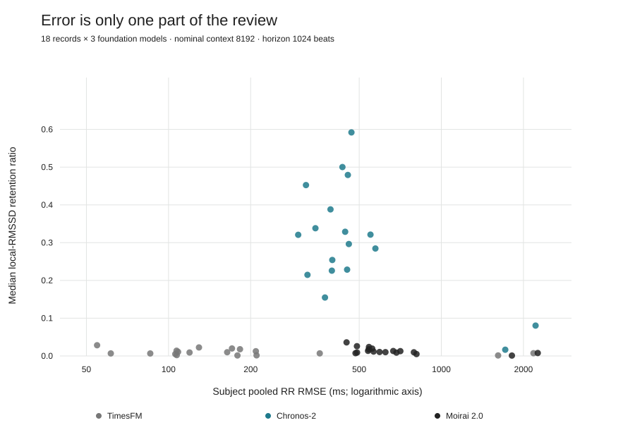
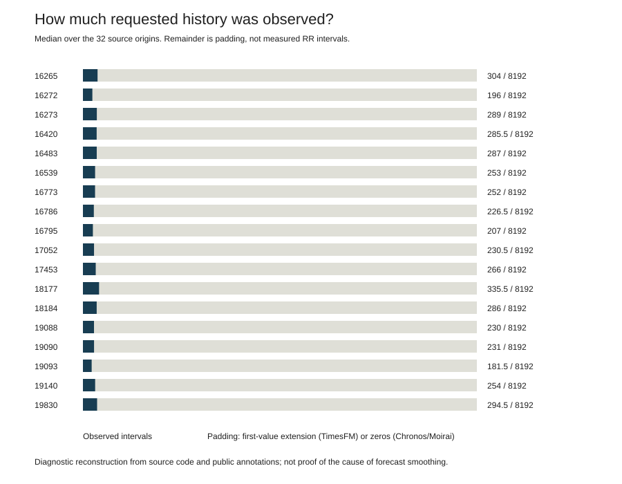

# When forecast error is not enough

A small, reproducible **secondary reanalysis** of SANDLab's public heartbeat-forecast benchmark. It asks which saved forecasts merit a variability-sensitive follow-up, rather than choosing a model using average prediction error alone.

This is a research diagnostic—not a pain detector, autonomic-state classifier, clinical decision rule, or independent validation. No foundation model was trained or rerun. The analysis and interface were developed with AI assistance; the contribution is a transparent, inspectable evaluation workflow.

## The question

An RR interval is the time between consecutive annotated heartbeats. A model can predict those intervals with relatively low error while returning a smoother sequence than the observed one. That matters if the eventual goal is to study physiological variation, but **smooth point predictions alone do not prove that a model's predictive distribution is poorly calibrated**.

The demo compares interval error with retained local beat-to-beat variation for the same 18 records, then checks a concrete follow-up issue: how much of the requested model history was actually observed?

## Inputs and provenance

- [SANDLab's benchmark repository](https://github.com/SubramanianLab/ecg-tsfm-benchmark), commit `ba350e1c6b8f40448335e363d367789f4cada3ef`, accompanying *Evaluating Long-Range Temporal Structure in Foundation Model-Based Forecasts of Heartbeat Dynamics* ([2026 preprint](https://www.biorxiv.org/content/10.64898/2026.05.25.727760v2)).
- Eighteen per-subject summary tables and eighteen per-subject step-metric tables, plus the official cohort table used for a reproduction check. These are **saved evaluation outputs**, not individual forecast traces.
- [MIT-BIH Normal Sinus Rhythm Database v1.0.0](https://physionet.org/content/nsrdb/1.0.0/): only 18 small annotation/header pairs are downloaded for the protocol audit. No ECG waveform download is needed. The cohort consists of referred subjects found to have no significant arrhythmias; it does not represent surgical, ICU, migraine, or other clinical populations.
- Every input has a pinned URL and SHA-256 in [source_manifest.json](source_manifest.json). See [PROVENANCE.json](PROVENANCE.json) for definitions and actual upstream component use.

The repository has no LICENSE file at this commit. **Upstream code, raw tables, and original figures are not republished here.** Reproduction fetches them to a private external cache. This repository contains independently authored code and compact derived factual summaries with attribution. The NSRDB source is offered under Open Data Commons Attribution License v1.0. The restricted PNAS 2024 surgical dataset was not accessed.

## Analysis decisions

1. **Match the available evidence.** Three foundation models—TimesFM, Chronos-2, Moirai 2.0—are compared at nominal context 8192 and forecast horizon 1024 beats. This is the only released setting with complete local-variability metrics for all 18 subjects and all three models. Missing settings are not replaced with zeros.
2. **Keep the subject as the descriptive unit.** Each saved subject result combines 32 nearby, overlapping forecast origins and two repeated annotation-derived lead inputs. These 64 series are not 64 independent subjects. The origins are near the beginning of each record, not a representative all-day sample.
3. **Convert units explicitly.** Saved RR quantities are in annotation sample units. The headers verify 128 Hz; error in milliseconds is `source value × 1000 / 128`. Horizon is in beats, not seconds.
4. **Define variability precisely.** The source computes RMSSD in overlapping 16-beat windows. At each of 1009 positions it divides the mean predicted RMSSD by the mean observed RMSSD across included series. Our subject statistic is the **median of these 1009 ratios**. This is not the mean of individual forecast ratios, not a long-range dependence estimate, and not standard clinical HRV. Broad beat annotations are retained, so “RR” is more accurate than “normal-to-normal.”
5. **Review two criteria together.** The interface applies an illustrative RMSE ceiling and two-sided retention factor. Factor 2 means retention from 0.5 through 2; inflated variability does not automatically pass. These user-selected tolerances are not clinically validated. Exporting a review list records the criteria instead of declaring a winning model.
6. **Audit the requested history.** The source's first 32 origins occur 64–312 seconds after record start. Annotation-based reconstruction finds only **41–555 observed RR intervals**, although 8192 were requested. TimesFM left-extends the first observed value; Chronos-2 and Moirai zero-pad. The actual unmodified TimesFM helper is run privately on all 576 reconstructed histories to check this behavior. Padding is a reason to design a controlled rerun, **not an established explanation for the observed smoothing**.

7. **Keep target-annotation QC visible.** For each subject we take the union of the same 32 future target-index ranges, count unique RR intervals strictly over 2 seconds, and show the maximum interval. This is a descriptive flag, not a clinical cutoff or exclusion rule. Records 16272 and 19088 contain annotation-derived target gaps of 39.39 and 68.69 seconds respectively. Filtered beat annotations can bridge noisy or unannotated segments, so their variation must not automatically be interpreted as biological variation. All original metrics remain unchanged.

The released per-subject LSTM is omitted from the matched comparison: its pooled within-subject training design differs and overlapping later contexts can include earlier forecast targets. We do not present it as an independent zero-shot competitor.

## Results

Model summaries below are medians across the 18 subject-level results.

| Model | RR RMSE (ms) | Retained local RMSSD | Joint passes at ≤200 ms and factor 2 |
| --- | ---: | ---: | ---: |
| TimesFM | 146.67 | 0.0082 | 0 / 18 |
| Chronos-2 | 439.00 | 0.3086 | 0 / 18 |
| Moirai 2.0 | 579.09 | 0.0110 | 0 / 18 |

TimesFM meets the illustrative error ceiling for 13/18 records, but none of those records also meets the selected local-variability range. This is a specific consequence of those chosen criteria, not a general model-quality verdict. The interface supports inspecting the other quadrants and changing tolerances. All records, including high-error outliers, remain included.

The source's equal-subject arithmetic mean RMSEs are also reproduced to numerical precision (341.33, 589.56, and 756.24 ms respectively). Reproduction establishes agreement with released tables—not independent validation.

### Figures





The derived JSON also includes 64-beat summary bins, using the root mean square of per-step RMSE values and the median of available local-retention positions. These are available for further analysis, not displayed as reconstructed heartbeat traces. Exact subject results are in [results.csv](results.csv); origin-level context counts are in [history-audit.csv](history-audit.csv).

## Reproduce

Tested with Python 3.12. Use a virtual environment:

```sh
python3 -m venv .venv
source .venv/bin/activate
pip install -r requirements.txt
python analysis.py --fetch
python -m unittest -v test_analysis.py
python -m http.server 8000
```

Open `http://localhost:8000`. The default private input cache is `~/.cache/sandlab-reanalysis-ba350e1`; no upstream file is stored in this public folder. Downloads total about 103 MB, mostly the released step tables. SHA mismatch is a hard error, not an automatic update. Transient network failures retry up to three times; rerunning reuses already verified files.

For an already fetched private source root containing `ecg-tsfm-benchmark/` and `nsrdb/`:

```sh
python analysis.py --source-root /absolute/private/source-root
```

Use `--cache /absolute/private/cache` to change download storage, or `--output /absolute/output-folder` for generated artifacts. `analysis.py` reproduces data, CSVs, provenance and both SVG figures. It deliberately does not alter the website's HTML/CSS/JS interface. No GPU or model weights are required.

Tests check matched coverage, nonmissing metrics, profile aggregation, subject summaries, inclusive two-sided tolerance logic, observed-history counts, exact official-table reproduction, source-manifest structure, and export consistency. The source run also verifies every downloaded file, identical observed variability across models, and the actual upstream padding helper.

## Limitations and one next experiment

These are reused outputs from one small public cohort. No clinical labels, downstream physiological task, held-out clinical population, model-training-data audit, or uncertainty-calibration rerun is provided. The overlapping origins and sliding variability windows must not be treated as independent replicates. Very large RR errors should prompt annotation and input QC; they are not evidence of disease.

**Next experiment:** inspect annotation gaps and define a prospective QC protocol, then choose temporally separated origins with genuinely observed, matched RR histories; compare the same models with a persistence baseline and sampled predictive trajectories; predefine a variability-sensitive physiological task and evaluate calibration as well as point error. That would test whether the current diagnostic matters downstream without assuming padding is the cause.

## Plain-language walkthrough: what Cathy can say

- **Biological motivation:** I want to understand what useful physiological information survives when a model forecasts heartbeat intervals. This is one limited part of sensing and state estimation—not a complete neural interface.
- **What the inputs mean:** the lab's tables tell us how its saved forecasts compared with annotated heartbeats. The PhysioNet annotations let us count how much prior heartbeat information was available to those forecasts.
- **What I added:** a matched, subject-level joint review of interval error and local variation, an exportable diagnostic list, and an observed-history audit with reproducible inputs.
- **What the results support:** low interval error did not ensure the selected local-variation tolerance in these saved outputs. The nominal context also greatly exceeded observed history at the evaluated origins.
- **What I should not claim:** I did not train these foundation models, discover physiological states, prove that padding caused smoothing, independently validate the paper, or establish clinical readiness. The project was developed with AI assistance.
- **A natural outreach sentence:** “I made a small reanalysis of your public heartbeat benchmark to inspect, record by record, when lower forecast error still comes with substantial smoothing of local RR variation. I also added an observed-history check to help frame a controlled follow-up.”
